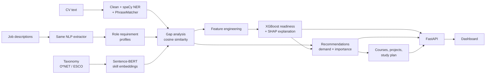

# SkillPulse: Intelligent Career Readiness & Skill Gap Prediction Platform

SkillPulse reads a CV, works out which skills a candidate has, compares them with what employers ask for in real job descriptions, predicts how ready the candidate is for a target role, and recommends what to learn next with courses, projects and a week-by-week study plan.

It is an AI/ML system built on spaCy NLP, Sentence-BERT embeddings, cosine-similarity gap analysis and an XGBoost classifier, served by a FastAPI backend with a web dashboard.

## Methodology → code

| # | Stage | What it does | Code |
|---|-------|--------------|------|
| 1 | **Data collection** | Job descriptions, a skill taxonomy and labelled resumes. Ships with a generated sample corpus (1,350 JDs, 4,000 CVs) and importers for Kaggle job postings, resume/placement data, **O\*NET** and **ESCO**. | `scripts/generate_sample_data.py`, `scripts/ingest_external.py`, `data/taxonomy/` |
| 2 | **Preprocessing & NLP extraction** | Text cleaning, section splitting, skill extraction with a spaCy **PhraseMatcher** over 68 skills and their synonyms, and **NER** (`en_core_web_sm` plus an EntityRuler for SKILL and DEGREE entities). Also parses experience from date ranges, internships, projects, certifications, degree level, field and GPA. | `app/nlp.py` |
| 3 | **Skill embedding** | Every taxonomy skill is encoded with **Sentence-BERT** (`all-MiniLM-L6-v2`) from its name, category and synonyms. Vectors are precomputed at training time. | `app/embeddings.py` |
| 4 | **Gap analysis** | **Cosine similarity** between the user's skill vector and the role's requirement vector, plus per-skill matching. Each required skill is *matched*, a *semantic match* (e.g. TensorFlow for PyTorch), *partial* or *missing*. Role requirements are mined from JDs (frequency → importance; market-wide frequency → demand). | `app/gap.py`, `app/role_profiles.py` |
| 5 | **Readiness prediction** | 13 engineered features (skill overlap %, weighted and core coverage, semantic similarity, experience and experience gap, internships, projects, certifications, education level, education match, GPA, skill count) feed an **XGBoost** classifier with early stopping and an F1-tuned threshold. Each prediction is explained with **SHAP** (TreeSHAP) contributions. | `app/features.py`, `app/model.py` |
| 6 | **Recommendation generation** | Missing skills ranked by `(1 − coverage) × importance × (0.5 + 0.5 × demand)`. Each one maps to courses and a portfolio project, gets a *predicted readiness gain* from re-running the model, and is placed in a study plan ordered by **topological sort** over skill prerequisites. | `app/recommend.py`, `data/taxonomy/courses.csv` |
| 7 | **Evaluation** | Accuracy, precision, recall, F1 and ROC-AUC on a held-out test set; 5-fold cross-validation; baselines (logistic regression, random forest); and NLP extraction precision/recall/F1 against ground-truth skills. Writes JSON and charts. | `scripts/train.py`, `reports/` |
| 8 | **Deployment** | FastAPI backend (`/api/...`, Swagger at `/docs`) serving the dashboard frontend, containerised with a two-stage Dockerfile. | `app/api.py`, `frontend/`, `Dockerfile` |



## Results (sample corpus)

Held-out test set of 600 CVs (train 2,799 / validation 601 / test 600):

| Model | Accuracy | Precision | Recall | F1 | ROC-AUC |
|---|---|---|---|---|---|
| **XGBoost** (threshold 0.42) | 0.757 | 0.729 | 0.808 | 0.767 | 0.853 |
| Logistic regression | 0.775 | 0.768 | 0.781 | 0.775 | 0.857 |
| Random forest | 0.760 | 0.768 | 0.737 | 0.753 | 0.850 |
| XGBoost, 5-fold CV (mean ± sd) | 0.774 ± 0.018 | 0.748 ± 0.020 | 0.818 ± 0.016 | 0.781 ± 0.017 | 0.861 ± 0.014 |

NLP skill extraction on 4,000 CVs: precision 0.998, recall 1.000, F1 0.999. Experience, internships, projects, certifications, degree level and field were all parsed correctly.

The most important features are skill overlap, weighted skill coverage and core skill coverage, followed by internships and years of experience. Charts are in `reports/` (`feature_importance.png`, `roc_curve.png`, `confusion_matrix.png`, `learning_curve.png`).

**How to read these numbers.** The sample corpus is generated, so:
- The labels come from a hidden scoring rule with deliberate noise, which caps achievable AUC at about 0.86. That rule is close to linear, which is why logistic regression matches XGBoost here. XGBoost's advantage (non-linear interactions, native handling of missing GPA, SHAP explanations) shows on real data.
- Extraction scores are near perfect because the sample CVs only use taxonomy terms. Expect lower recall on real CVs. Measure it by annotating 50–100 real CVs with their true skills (`true_skills` column) and re-running training.
- These numbers were produced with the TF-IDF fallback embeddings, because Sentence-BERT could not be downloaded in the environment where this was built. Run training anywhere Hugging Face is reachable (your laptop, or the Docker build) to use Sentence-BERT. That improves semantic matching, e.g. PyTorch ↔ TensorFlow.

## Run it locally

Requires Python 3.11+.

```bash
python -m venv .venv && source .venv/bin/activate      # Windows: .venv\Scripts\activate
pip install torch --index-url https://download.pytorch.org/whl/cpu   # optional, smaller CPU build
pip install -r requirements-train.txt

python -m scripts.train          # generates sample data if missing, trains, evaluates (~2 min)
uvicorn app.api:app --reload     # open http://localhost:8000  (API docs at /docs)
pytest -q                        # 8 tests
```

Trained artifacts are already included in `artifacts/`, so `pip install -r requirements.txt` followed by `uvicorn app.api:app` is enough to run the dashboard immediately.

## Use real data

```bash
# 1. Download into data/external/: Kaggle job postings, O*NET "Technology Skills.txt", ESCO "skills_en.csv",
#    and a CSV of CVs with an outcome label (e.g. placement records).
python -m scripts.ingest_external jobs data/external/postings.csv --title-col title --text-col description
python -m scripts.ingest_external taxonomy --onet "data/external/Technology Skills.txt" --esco data/external/skills_en.csv
python -m scripts.ingest_external resumes data/external/resumes.csv --text-col resume_text --role-col target_role --label-col placed
python -m scripts.train
```

Job titles are mapped to the 9 roles through `title_keywords` in `data/taxonomy/roles.json`. Add roles or skills by editing `roles.json` and `skills.csv`, then retrain.

## API

| Method | Endpoint | Purpose |
|---|---|---|
| GET | `/api/health` | Status, embedding backend, NER availability |
| GET | `/api/roles` | Role profiles mined from job descriptions |
| GET | `/api/skills` | Skill taxonomy |
| GET | `/api/skills/{id}/similar` | Nearest skills by embedding similarity |
| POST | `/api/extract` | CV text → skills, entities, experience, education |
| POST | `/api/analyze` | Readiness score, SHAP explanation, gap analysis, recommendations, study plan, role ranking |
| GET | `/api/metrics` | Evaluation report |

```bash
curl -X POST localhost:8000/api/analyze -H "Content-Type: application/json" \
  -d '{"target_role":"data_analyst","skills":{"sql":3,"excel":4,"python":2},"internships":1,"degree_level":2,"degree_field":"statistics"}'
```

## Deploy to a public website

The Dockerfile has two stages. The first trains the models with Sentence-BERT. The second is a slim runtime image with no PyTorch, so it fits free hosting tiers.

**Option A: Hugging Face Spaces (free, recommended)**
1. Create a free account at huggingface.co, then go to *New Space*, choose **SDK: Docker** and a blank template.
2. Push this folder to the Space's git repository:
   ```bash
   git init && git add . && git commit -m "SkillPulse"
   git remote add space https://huggingface.co/spaces/<your-username>/skillpulse
   git push space main
   ```
3. The Space builds the image (about 10 minutes the first time) and serves the app at `https://<your-username>-skillpulse.hf.space`. The YAML header at the top of this README configures it.

**Option B: Render**
1. Push the folder to a GitHub repository.
2. In Render, go to *New → Blueprint*, select the repo, and `render.yaml` sets up a free Docker web service with a health check.
3. The app goes live at `https://skillpulse-xxxx.onrender.com`. Free instances sleep when idle, so the first request after a pause takes about 30 seconds.

**Any Docker host**
```bash
docker build -t skillpulse . && docker run -p 8000:8000 skillpulse
```

## Project structure

```
app/            config, taxonomy, nlp, embeddings, role_profiles, gap, features, model, recommend, service, api
frontend/       dashboard (index.html, app.js, style.css)
scripts/        generate_sample_data, build_courses, ingest_external, train
data/taxonomy/  skills.csv (68 skills, aliases, prerequisites), roles.json (9 roles), courses.csv
data/raw/       job_descriptions.csv, resumes.csv
artifacts/      readiness_xgb.json, readiness_meta.json, role_profiles.json, skill_embeddings.npz
reports/        evaluation.json, features.csv, charts
tests/          pytest suite
```

## Limitations and future work

- Real labelled outcomes (shortlisting or placement data) are needed before trusting the scores for real decisions. Readiness predictions should support career advice, not replace human judgement.
- The PhraseMatcher only finds skills that are in the taxonomy. Enrich it from ESCO or O*NET, or add a trained spaCy NER model for unseen skills.
- Demand is measured from the job-description sample. Refresh it regularly from live postings.
- Fairness: audit predictions across gender, institution and region before any real-world use.
